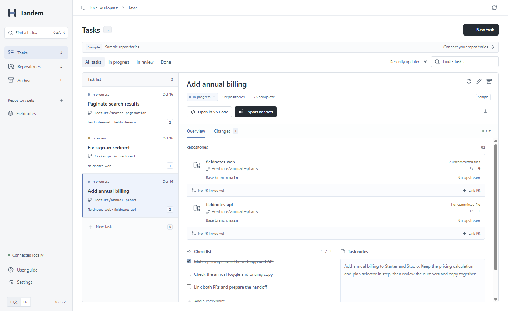

# Tandem / 同序

A local desktop workspace for tasks spanning independent Git repositories. Keep the branches, changes, PRs and handoff for one task together, while each repository keeps its own Git history.

Windows x64 · English / 简体中文 · No account required

Version **0.3.2** fixes Windows path aliases during recovery, improves task search and preserves all source lines in the diff viewer. [Release notes](docs/RELEASE-0.3.2.md) · [Data reliability](docs/RELIABILITY-0.3.md). Close older versions before upgrading.

[简体中文](README.zh-CN.md) · [Design notes](docs/PRODUCT.md) · [Architecture](docs/ARCHITECTURE.md) · [Validation](docs/VALIDATION.md)



## Install

Download the [Windows x64 installer](https://github.com/xiao-zi-chen/Tandem/releases/download/v0.3.2/Tandem-Setup-0.3.2-x64.exe) from [GitHub Releases](https://github.com/xiao-zi-chen/Tandem/releases/tag/v0.3.2). Checksums and build information are available beside it. Install, connect your repositories and create your first task; the optional sample workspace is a quick way to try the workflow.

The desktop application includes its Electron runtime. **Users do not need Node.js or Python.** Git must be installed and available on PATH; Settings shows the detected Git version. The installer is currently unsigned.

The installer includes the application icon, version metadata, shortcuts, and an uninstaller. Users do not need to start a web server. The existing `启动同序.cmd` launcher prefers the desktop build and falls back to the browser development preview only when a desktop build is unavailable.

## Workflow

1. Connect existing local Git repositories using the native folder picker or a path.
2. Create a task with one worktree per repository, or attach existing checkouts and their local changes.

   Select **Use an existing branch** to use an unoccupied local branch. Failure recovery preserves that branch and its original commits.

3. Review unstaged, staged, untracked and committed changes separately. Filter files and inspect both paths of renames.
4. Link GitHub PRs, maintain a checklist and save task notes.
5. Export a Markdown handoff through a native save dialog or copy it to the system clipboard.
6. Archive completed tasks without deleting branches or worktrees.

Press **Ctrl+K** to find a task by name, repository, branch or linked PR. Combine terms such as `web #123`; use the arrow keys and Enter to open a result. You can save frequently used repository combinations and start another task from them.

The optional sample workspace creates two actual local Git repositories and three tasks. Its displayed changes come from Git; it is a workflow example, not a runnable full-stack application.

## Desktop integration

Tandem provides a native window, application menus, editing context menus, folder/save dialogs, clipboard integration, keyboard shortcuts, and single-instance activation. Window bounds, language and the selected task survive a restart. External GitHub links open in the system browser.

Settings shows the version, Git availability and data directory. An existing Tandem workspace or an empty folder can be selected as another data directory. Nonempty ordinary project folders are rejected.

## Data

Desktop data defaults to the current user's application-data location. Use **Settings → Data directory** to inspect the actual path.

```text
data/
  state.json          repositories, tasks and operation journal
  state.backup.json   previous valid metadata snapshot
  workspaces/         real task worktrees and editor workspace files
  sample-project/     optional sample repositories
```

Local note drafts survive task navigation. Saving checks the task revision to prevent silently overwriting an edit from another window. Metadata is validated, synced to a temporary file and atomically replaced; invalid state is preserved rather than reset.

When primary data is missing or invalid, the desktop application validates the backup before offering **Restore backup and restart**. The damaged original is preserved. On the first mutation, older workspaces migrate to data format 2 with an original `state.v1.backup.json` retained. Continue using version 0.3 or newer for migrated workspaces.

The older browser preview's `.tandem/` directory is retained. Close any service using it, then select it from **Settings → Open another workspace**. No repository or worktree is moved.

The metadata backup is **not a source-code or working-file backup**. Do not delete the data directory to reset the UI. Linked worktrees depend on their original repository's Git directory.

## Release boundaries

Windows x64 is the verified desktop target. Code signing, automatic updates and macOS/Linux installers are not provided. The installer wizard has not been executed on this machine; native tests run the actual packaged application used by the installer. See [validation](docs/VALIDATION.md) for the specific test coverage.

Only GitHub PR links are supported. Status refresh uses an existing GitHub CLI login where available and the Electron network stack for public requests in the desktop application. Unavailable status remains **Unverified**. The app does not push, merge, run project setup scripts or infer CI/deployment readiness.

Worktrees do not isolate dependencies, ports or databases. General worktree deletion remains with the user's Git tools. Recovery only removes unchanged resources created by a failed operation.

## Develop and verify

Development uses Node.js 24 LTS and Git. The application uses React, TypeScript and Electron, with the Git service running directly in the desktop main process.

```sh
npm ci
node node_modules/electron/install.js
npm run desktop:dev
```

```sh
npm test
npm run build
npx playwright install chromium
npm run test:e2e
npm run desktop:dist
npm run test:desktop
npm run release:manifest
```

When downloading Electron through an HTTP(S) proxy on Node.js 24, `NODE_USE_ENV_PROXY=1` may be needed. Installer users already have the runtime bundled.

`npm run dev` remains available as a browser preview. Tests use temporary directories and independent Git repositories. GitHub Actions runs Windows checks for source changes; the manual release workflow builds a version tag and prepares a draft release.

## Feedback and project status

[Report an issue or describe a workflow](https://github.com/xiao-zi-chen/Tandem/issues/new/choose) in English or Chinese. Include the Tandem and Git versions from Settings and reproducible steps. [Development and release guide](CONTRIBUTING.md).

This is an early release for real-task evaluation. The project is currently **UNLICENSED**; the owner has not yet selected an open-source license. Third-party dependencies retain their own licenses.
