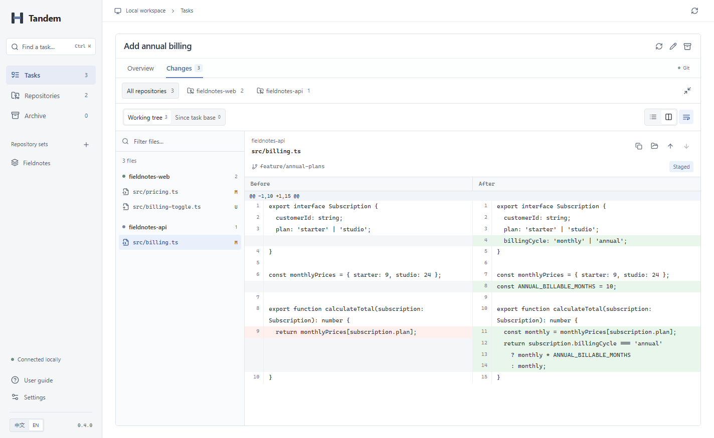
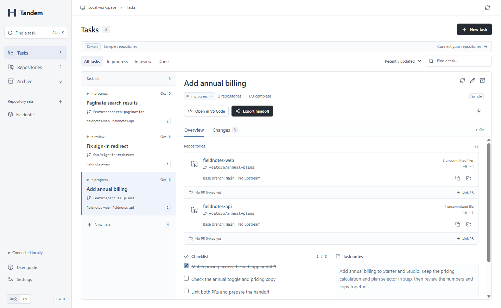



  

<h1 align="center">Tandem</h1>

  <strong>One task. Multiple repositories.</strong> 
  Keep your branches, changes, and pull requests together. 
  Each repository keeps its own Git history.

  <a href="https://github.com/xiao-zi-chen/Tandem/releases/tag/v0.4.0">Download for Windows</a> ·
  <a href="docs/QUICKSTART.md">Quick start</a> ·
  <a href="https://github.com/xiao-zi-chen/Tandem/issues/new/choose">Feedback</a> ·
  <a href="README.zh-CN.md">简体中文</a>

  
  
  

Actual Windows app · Built-in sample repositories · English and Simplified Chinese

## A workspace for the whole task

An API change often needs a frontend change too. The work belongs together, even when the repositories don't. Tandem is a local desktop app that groups the worktrees, diffs, linked PRs, and notes for that task in one place.

Use your usual editor and Git tools to write, commit, and push. Use Tandem to prepare the task, review changes across repositories, and leave a clear handoff.

| When you need to…                           | Tandem helps you…                                                                                                   |
| ------------------------------------------- | ------------------------------------------------------------------------------------------------------------------- |
| Start a feature across several repositories | Create a worktree for each repository, choose a new or existing unoccupied branch, and reuse saved repository sets. |
| Bring ongoing work together                 | Attach existing checkouts, including their uncommitted changes.                                                     |
| Review the whole change                     | Browse files grouped by repository, search paths, and switch between unified and side-by-side diffs.                |
| Pick up where you left off                  | Find a task with **Ctrl+K**, keep notes and checklists, and open its workspace in VS Code.                          |
| Hand work to someone else                   | Collect GitHub PR links and export a Markdown summary with the task's repositories, branches, and notes.            |

See the task overview and handoff

**Task overview** — branches, repository status, linked PRs, and notes.

**Handoff** — preview the Markdown before copying or saving it.

## Download and try it

**[Download Tandem 0.4.0 for Windows x64](https://github.com/xiao-zi-chen/Tandem/releases/download/v0.4.0/Tandem-Setup-0.4.0-x64.exe)** · [Release notes and checksums](https://github.com/xiao-zi-chen/Tandem/releases/tag/v0.4.0)

You need **Windows x64 and Git on PATH**. Node.js and Python are not required to use the installer. No Tandem account is required.

> **Windows preview:** the installer is unsigned. Automatic updates and macOS/Linux installers are not available. Close older versions before upgrading. See [what has been tested](docs/VALIDATION.md).

1. Install and open Tandem. Settings shows whether Git is available.
2. Choose **Open sample workspace** to explore two real local sample repositories, or **Connect repository** to select your own.
3. Create a task, select its repositories, then open **Changes** to review them together.

The sample uses actual Git changes and can be explored without connecting your own repositories. For branch choices, PR links, shortcuts, and troubleshooting, see the **[quick start](docs/QUICKSTART.md)**.

## Fits your existing Git workflow

- **Independent repositories.** Each retains its own commits, branches, and remotes. A task groups their working directories.
- **Local task data.** Repositories, notes, and workspace metadata live on your computer. GitHub PR status refresh makes network requests; it uses an existing GitHub CLI login when available.
- **Explicit lifecycle.** Archiving a task keeps its branches and worktrees. Remove worktrees through your usual Git tools when you are ready.
- **Protected edits.** Note drafts, revision checks, atomic metadata writes, and a previous metadata snapshot help preserve your work. The snapshot does not back up source files. [Data and recovery →](docs/DATA.md)

Worktree creation does not install project dependencies or isolate ports and databases. Tandem links existing GitHub PRs; pushing, opening PRs, and merging stay in your existing tools. Unavailable PR status is shown as **Unverified**.

## Documentation

| Guide                                                                     | What you will find                                         |
| ------------------------------------------------------------------------- | ---------------------------------------------------------- |
| [Quick start](docs/QUICKSTART.md) · [中文](docs/QUICKSTART.zh-CN.md)      | First task, review workflow, PR links, and common problems |
| [Data and recovery](docs/DATA.md) · [中文](docs/DATA.zh-CN.md)            | Storage, backups, upgrading, and switching workspaces      |
| [Development guide](CONTRIBUTING.md)                                      | Local setup, project structure, checks, and releases       |
| [Architecture](docs/ARCHITECTURE.md)                                      | Desktop boundaries, Git operations, and persistence        |
| [Validation](docs/VALIDATION.md) · [Release notes](docs/RELEASE-0.4.0.md) | Verified behavior, test coverage, and current limits       |

## Help shape Tandem

Try it on a real task that spans two repositories. Tell us which step saved time, where you still switched tools, and whether the handoff helped. [Share a workflow](https://github.com/xiao-zi-chen/Tandem/issues/new?template=feature_request.yml) or [report a bug](https://github.com/xiao-zi-chen/Tandem/issues/new?template=bug_report.yml) in **English or Chinese**.

Documentation, translation, and focused fixes are welcome. Read the [development guide](CONTRIBUTING.md) before preparing a change.

**Project status:** early Windows preview, intended for real-task evaluation. The project is **UNLICENSED**; the owner has not selected an open-source license. Third-party dependencies retain their own licenses.
