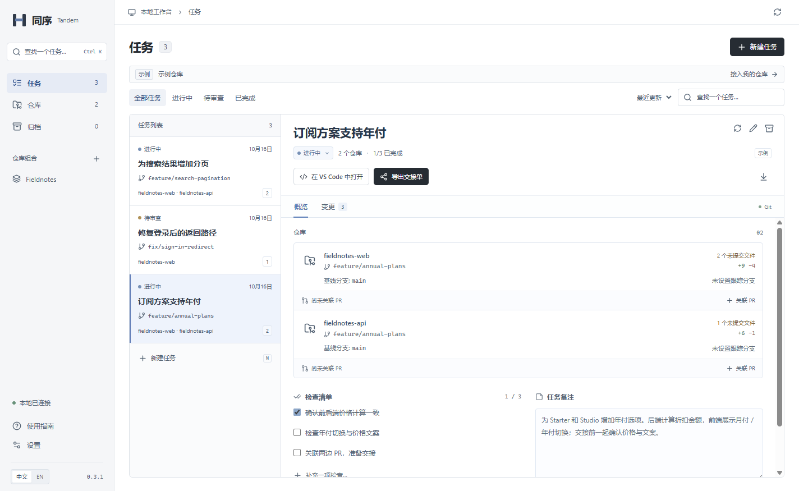

# 同序 / Tandem

本地多仓库任务工作台。把一个任务涉及的分支、差异、PR 和交接说明放在一起，同时保留每个仓库独立的 Git 历史。

Windows x64 · 简体中文 / English · 无需注册账号

**0.3.1** 完善任务搜索，并修复差异查看器漏行问题。[更新记录](docs/RELEASE-0.3.1.md) · [数据可靠性](docs/RELIABILITY-0.3.md)。升级前请先退出旧版本。

[English](README.md) · [界面调整](docs/PRODUCT.md) · [实现结构](docs/ARCHITECTURE.md) · [验证记录](docs/VALIDATION.md)



## 安装和运行

从 [GitHub Releases](https://github.com/xiao-zi-chen/Tandem/releases/tag/v0.3.1) 下载 [Windows x64 安装包](https://github.com/xiao-zi-chen/Tandem/releases/download/v0.3.1/Tandem-Setup-0.3.1-x64.exe)，按安装向导选择目录。同页提供校验文件与构建信息。安装后连接仓库即可创建任务；也可以先打开示例工作台熟悉流程。

程序内置 Electron 运行时，使用时**不需要安装 Node.js 或 Python**。本机需要安装 Git，并能通过 PATH 找到；可以在「设置」查看检测结果。安装包目前未签名。

安装包包含应用图标、产品版本、快捷方式和卸载程序。不会要求用户手工启动浏览器服务。已有的 `启动同序.cmd` 会优先启动桌面程序，只有不存在桌面构建时才使用网页开发预览。

## 使用流程

1. 点击「连接仓库」，通过系统文件夹选择器选择已有 Git 仓库，也可以直接填写路径。
2. 创建任务，选择涉及的仓库。可以分别创建 worktree，也可以接入已经使用的工作目录。

   在「创建新工作区」中勾选「使用已有分支」，可选择未被其他 worktree 占用的本地分支；回滚不会删除这个原有分支。

3. 在任务中查看每个仓库的工作区、暂存区、新文件和分支累计差异。文件列表支持筛选，重命名会保留原路径信息。
4. 关联各仓库的 GitHub PR，填写检查清单与任务备注。
5. 使用系统保存对话框导出 Markdown 交接单，或通过原生剪贴板复制；同事无需安装同序也能阅读。
6. 归档只整理任务列表，保留原有工作目录、分支与修改。

按 **Ctrl+K** 搜索任务名、仓库、分支或关联 PR；可组合输入 `web #123`，用方向键与回车打开结果。常用仓库组合可以保存，下一次从组合直接创建任务。

首次也可以打开示例工作台。示例包含两个真实的本地 Git 仓库与三个任务，显示的差异来自 Git；示例代码不是已经配置好运行环境的前后端应用。

## 桌面功能

- 原生窗口、文件/编辑/查看/语言/帮助菜单与编辑右键菜单。
- `Ctrl/⌘ K` 搜索，原生菜单快捷键新建任务和连接仓库。
- 原生文件夹选择、保存对话框和剪贴板。
- 关闭重开后保留语言、所选任务、窗口大小和位置。
- 单实例启动；再次打开会显示已有窗口。
- 设置中查看版本、Git 状态和数据目录，也可打开其他工作台。
- GitHub 链接交由系统浏览器打开，应用窗口只加载本地界面。

## 数据和旧版工作台

默认数据位于当前用户的 Windows 应用数据目录。请在「设置 → 数据目录」查看实际路径。

```text
data/
  state.json          当前任务、仓库与操作记录
  state.backup.json   上一次有效元数据快照
  workspaces/         创建的 worktree 与编辑器工作区文件
  sample-project/     可选的示例仓库
```

备注草稿保存在本机；切换任务不会直接丢弃草稿。保存时会检查任务版本，发现其他窗口的更新后保留输入并提示冲突。元数据文件会经过结构校验，再以临时文件同步写入并原子替换；损坏文件不会被自动清空。

主文件缺失或损坏时，桌面版会先检查备份，再提供「恢复备份并重启」。恢复前会保留损坏原件。0.3 首次修改旧工作台时升级到数据格式 2，并另外保留原始 `state.v1.backup.json`；升级后的目录请继续使用 0.3 或更新版本。

旧网页版的 `.tandem/` 已保留。关闭使用该目录的旧服务后，可以在桌面版「设置 → 打开其他工作台」选择它。此操作不移动原仓库或 worktree。非空的普通项目目录不会被当成新的同序数据目录使用。

`state.backup.json` 只备份任务元数据，**不是源码或未提交文件的完整备份**。不要删除数据目录来重置界面。linked worktree 依赖原仓库的 Git 目录，备份时需要一起考虑。

## 当前边界

目前验证的平台为 Windows x64。尚未提供签名版本、自动更新服务或 macOS/Linux 安装包。安装向导没有在本机实际执行，自动化验证使用安装包对应的实际打包程序。具体覆盖范围见[验证记录](docs/VALIDATION.md)。

PR 关联目前支持 GitHub。刷新时优先使用现有 `gh` 登录，公开请求在桌面版走 Electron 网络栈；无法核实的状态仍显示「未确认」。没有自动推送、合并、运行项目脚本或推断 CI/部署完成。

创建 worktree 不会自动安装项目依赖、配置端口或隔离数据库。通用 worktree 清理由用户原有 Git 工具处理；失败恢复仅移除该操作创建且仍无新工作的资源。

## 开发与验证

开发使用 Node.js 24 LTS、Git。源码使用 React、TypeScript、Electron，Git 服务直接运行在桌面主进程中。

```sh
npm ci
node node_modules/electron/install.js
npm run desktop:dev
```

```sh
npm test
npm run build
npx playwright install chromium
npm run test:e2e
npm run desktop:dist
npm run test:desktop
npm run release:manifest
```

如果开发机使用 HTTP(S) 代理，下载 Electron 时可在 Node.js 24 下设置 `NODE_USE_ENV_PROXY=1`。这不影响安装包用户，运行时已随应用提供。

`npm run dev` 仍可运行浏览器开发预览。测试使用临时目录和独立仓库，不操作用户登记的仓库。GitHub Actions 对源码变更执行 Windows 检查；手动发布工作流从版本标签构建并准备草稿发布。

## 反馈与项目状态

可以用中文或英文[反馈问题、描述使用流程](https://github.com/xiao-zi-chen/Tandem/issues/new/choose)。请附上设置中的同序版本、Git 版本和复现步骤。[开发与发布指南](CONTRIBUTING.md)。

当前是用于真实任务验证的早期版本。项目许可暂为 **UNLICENSED**，所有者尚未选定开源许可证；第三方依赖保留各自的许可。
