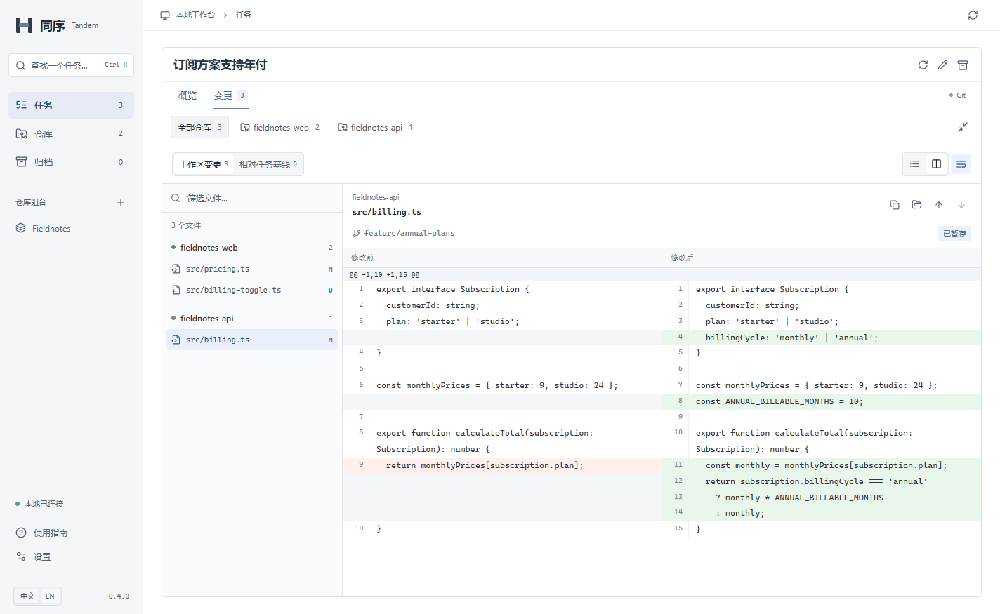
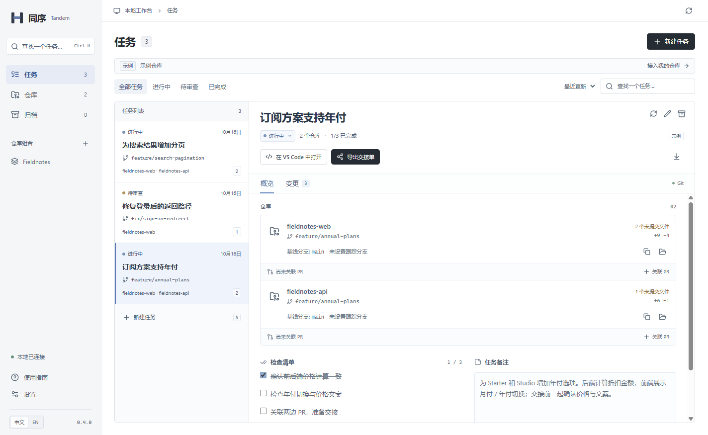
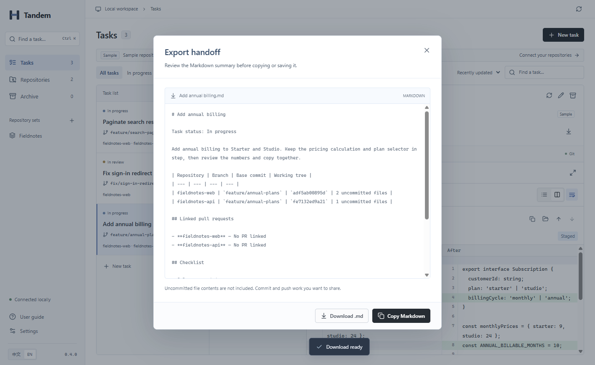



  

<h1 align="center">Tandem · 同序</h1>

  <strong>一个任务，多个仓库。</strong> 
  把分支、变更和 PR 放在一起， 
  每个仓库依然保留自己的 Git 历史。

  <a href="https://github.com/xiao-zi-chen/Tandem/releases/tag/v0.4.0">下载 Windows 版</a> ·
  <a href="docs/QUICKSTART.zh-CN.md">快速上手</a> ·
  <a href="https://github.com/xiao-zi-chen/Tandem/issues/new/choose">反馈建议</a> ·
  <a href="README.md">English</a>

  
  
  

Windows 成品实拍 · 内置示例仓库 · 完整中英文界面

## 围绕一个任务，把工作放在一起

改一个接口，往往也要改前端。工作属于同一个任务，代码却在不同仓库。同序是一款本地桌面工具，把这个任务涉及的 worktree、代码差异、PR 链接和备注集中起来。

继续使用熟悉的编辑器和 Git 工具编写、提交与推送代码；用同序准备任务工作区、集中审阅变更，再把上下文交接清楚。

| 当你需要……               | 同序可以帮你……                                                            |
| ------------------------ | ------------------------------------------------------------------------- |
| 开始一个跨仓库功能       | 为各仓库创建 worktree，选择新分支或未被占用的已有分支，复用常用仓库组合。 |
| 把正在进行的工作归到一起 | 接入已有工作目录，连同尚未提交的改动一起组织。                            |
| 看清整个任务改了什么     | 按仓库分组浏览文件、搜索路径，切换统一或并排差异。                        |
| 继续上次的工作           | 用 **Ctrl+K** 查找任务，保存备注与检查项，在 VS Code 中打开工作区。       |
| 把工作交给其他人         | 关联 GitHub PR，导出包含仓库、分支与备注的 Markdown 交接摘要。            |

查看任务概览与交接界面

**任务概览**：集中查看分支、仓库状态、关联 PR 与备注。

**交接摘要**：复制或保存前，先预览 Markdown 内容。下图为英文界面。

## 下载并试用

**[下载同序 0.4.0 · Windows x64](https://github.com/xiao-zi-chen/Tandem/releases/download/v0.4.0/Tandem-Setup-0.4.0-x64.exe)** · [版本说明与校验文件](https://github.com/xiao-zi-chen/Tandem/releases/tag/v0.4.0)

需要 **Windows x64，以及已加入 PATH 的 Git**。使用安装包无需 Node.js 或 Python，也无需注册同序账号。

> **Windows 预览版：**安装包尚未签名，暂不提供自动更新和 macOS/Linux 安装包。升级前请退出旧版本。实际验证范围见[验证记录](docs/VALIDATION.md)。

1. 安装并打开同序，在「设置」中确认 Git 可用。
2. 选择「打开示例工作台」，体验两个真实的本地示例仓库；也可以「连接仓库」，选择自己的项目。
3. 新建任务并选择仓库，进入「变更」，集中审阅各仓库的改动。

示例使用真实 Git 变更，无需先连接自己的仓库。分支选择、PR 关联、快捷键和常见问题见**[快速上手](docs/QUICKSTART.zh-CN.md)**。

## 接入你已有的 Git 工作方式

- **保留独立仓库。** 每个仓库保留自己的提交、分支和远端；任务负责关联它们的工作目录。
- **任务数据保存在本机。** 仓库、备注和工作台元数据都在本地；刷新 GitHub PR 状态时会发起网络请求，有可用的 GitHub CLI 登录时优先使用。
- **明确的任务生命周期。** 归档任务会保留分支和 worktree；需要清理时，使用原有 Git 工具处理。
- **保护编辑中的工作。** 备注草稿、版本冲突检查、原子元数据写入和上一份元数据快照共同减少意外丢失。快照不备份源文件。[数据与恢复 →](docs/DATA.zh-CN.md)

创建 worktree 不会安装项目依赖，也不会隔离端口或数据库。同序关联已有 GitHub PR；推送、创建 PR 与合并仍在原有工具中完成。无法核实的 PR 状态会显示「未确认」。

## 文档

| 指南                                                                 | 内容                                    |
| -------------------------------------------------------------------- | --------------------------------------- |
| [快速上手](docs/QUICKSTART.zh-CN.md) · [English](docs/QUICKSTART.md) | 第一个任务、变更审阅、PR 关联与常见问题 |
| [数据与恢复](docs/DATA.zh-CN.md) · [English](docs/DATA.md)           | 数据位置、备份、升级与切换工作台        |
| [开发指南](CONTRIBUTING.md)                                          | 本地开发、目录结构、验证与发布          |
| [技术架构](docs/ARCHITECTURE.md)                                     | 桌面隔离、Git 操作与持久化机制          |
| [验证记录](docs/VALIDATION.md) · [版本说明](docs/RELEASE-0.4.0.md)   | 已验证行为、测试覆盖与当前边界          |

## 一起把同序做得更好

试着用同序完成一个涉及两个仓库的真实任务。告诉我们哪一步省了时间、哪里还需要来回切换工具，以及交接摘要是否有用。欢迎用**中文或英文**[分享工作流程](https://github.com/xiao-zi-chen/Tandem/issues/new?template=feature_request.yml)或[反馈问题](https://github.com/xiao-zi-chen/Tandem/issues/new?template=bug_report.yml)。

欢迎改进文档、翻译和具体问题；准备提交修改前，请先阅读[开发指南](CONTRIBUTING.md)。

**项目状态：**用于真实任务验证的早期 Windows 预览版。项目当前为 **UNLICENSED**，所有者尚未选定开源许可证；第三方依赖保留各自的许可。
