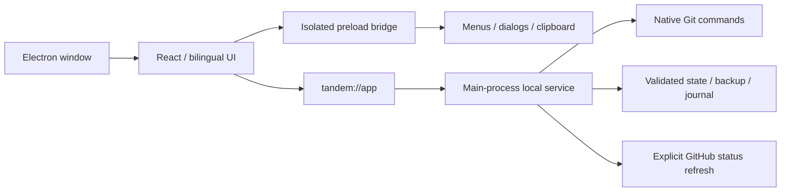

# Desktop architecture

## Process and packaging boundaries

`desktop/main.ts` owns the window, native integration, settings, single-instance behavior and local service. `desktop/preload.ts` exposes specific, validated operations. The renderer has no Node integration; context isolation and sandboxing are enabled and checked against the running desktop process.

Packaged assets are loaded from `tandem://app`, giving browser storage a stable origin across application restarts. API requests are forwarded internally to the main process's loopback service on a random port. Users do not manage this service. Native quit waits for service and metadata work to finish after window-close checks.

In 0.3 the service also tracks request handlers after their HTTP clients disconnect. Shutdown finishes those operations before releasing the workspace lease. Windows uses a kernel-held named pipe for exclusive writers; Linux uses an abstract socket. macOS has not been enabled for this locking implementation. Legacy live-process lock records are still respected.

The Windows build is produced by electron-builder as a branded executable and NSIS installer. It includes the runtime, application resources, icon, product version, shortcuts and uninstaller. There is no Python launcher or external Node installation requirement. The application still uses the machine's Git installation.

## Git and state

- Task creation validates all repositories and bases, journals operations, serializes mutations and uses idempotent operation IDs.
- Each repository keeps an independent Git history. Branch names and bases may differ between bindings.
- Recovery verifies repository identity, branch and original HEAD. It preserves tracked, untracked and ignored changes and refuses to force-remove unknown directories.
- Git commands use argument arrays, bounded process concurrency and NUL-delimited output. Diffs disable external diff/text conversion; renamed files include both old and new paths.
- `state-schema.ts` validates saved structures and migrates older tasks to revision zero. Invalid state is retained without automatic overwrite.
- Metadata saves retain the previous valid snapshot, sync the new temporary file and atomically replace the current state.
- Updates carry an expected task revision. Stale writes receive HTTP 409, and note drafts remain visible while the latest saved version is shown.
- Renderer note drafts use the stable local origin, survive task navigation and warn before leaving with unsaved work.

- A save acknowledges only the text that was submitted; newer typing remains a draft. Draft keys are isolated by task and language. If browser storage is unavailable, session memory retains the content and the application continues to warn before closing, including from other pages.
- Metadata transactions detach returned values, skip no-op writes and preserve backups when a primary file is missing. Explicit recovery validates backups, retains damaged originals and refuses to overwrite valid or newer-format data.
- Data format 1 migrates to format 2 on the first mutation, with `state.v1.backup.json` retained. Format 2 records whether an operation created a branch or only a worktree, so existing branches survive compensation.
- Preferences follow the same commit-after-write discipline. Workspace switches are persisted and relaunched only after the window actually closes; cancelling the close leaves the original directory active.

## Native integration

Native IPC validates the sending window and data shapes. Folder paths come from system dialogs. Save destinations come from system save dialogs; the renderer cannot pass an arbitrary destination path. Clipboard integration is write-only. Native context menus provide ordinary edit actions.

External windows are denied and permitted GitHub/Git links open in the system browser. Navigation away from the packaged origin, webviews and permission requests are blocked. The desktop network adapter uses Electron's network stack for public PR requests.

Changing workspaces accepts an empty directory or a valid existing Tandem state directory and rejects directories in use. The original repositories are not moved. The default data directory is under the current user's application-data path.

## Remaining limits

There is no code-signing identity, update server, remote development, runtime/container isolation or general worktree deletion in this release. Git hooks configured in user repositories retain Git's normal behavior. Native folder/save dialogs are called by the app; automated tests simulate their chosen results to verify the IPC and file operations without driving OS dialog controls.
